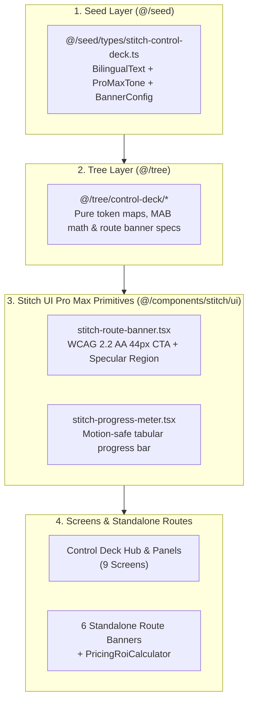

# `/ak-brainstorm --deep` — UI/UX Pro Max Deep Refactor & Bootstrap Plan

> **Date:** 2026-10-18
> **Scope:** `/Users/macbook/sophia-ai-factory/apps/sophia-ai-factory/src/components/stitch/` & `@/seed/types/stitch-control-deck.ts` → `@/tree/control-deck/*`
> **Method:** Binh Pháp Strategic Assessment (始計) + YAGNI / KISS / DRY + 4-Layer Architecture (`seed -> tree -> forest -> land`)

---

## 1. Brainstorm Contract (4 Mandatory Fields)

| Field | Specification |
|---|---|
| **Outcome** | Refactor the UI/UX Pro Max implementation across `src/components/stitch/` into a DRY, token-driven Obsidian-Gold primitive architecture (`StitchRouteBanner`, `StitchProgressMeter`, `StitchActionPill`) with zero duplicated Tailwind blocks and 100% `< 180 LOC` compliance across both source and test files. |
| **Constraints** | Preserve all 3 Protected Flows (`Setup Wizard`, `Telegram Bot`, `NOWPayments IPN`), maintain all existing `data-testid` / WAI-ARIA contracts, enforce `< 180 LOC` per file, `0 :any`, `0 console.*`, bilingual `VI/EN`, and 4-layer import boundaries. |
| **Non-goals** | No database schema migrations, no changes to NOWPayments/PayOS billing webhooks, and no breaking changes to public route URLs. |
| **Acceptance Criteria** | 1) Plan documented in `docs/architecture/ak-brainstorm-ui-ux-pro-max-deep-refactor.md`; 2) Shared `ui-ux-pro-max` primitives extracted and unit-tested; 3) 6 standalone route banners refactored to consume shared primitive (`-40%` duplicate JSX); 4) All 5 oversized `stitch` test files (`192–357 LOC`) split to `< 180 LOC`; 5) `check-layer-boundaries.sh`, `ci:typecheck`, `i18n:validate`, `verify:open-core`, `vitest`, and `playwright` exit `0`. |

---

## 2. Codebase Evidence & Diagnosis

### 2.1 Duplication Across the 6 Standalone Route Banners (`~318 LOC` total)
All 6 Phase 2 standalone route banners share identical structural boilerplate (Obsidian-Gold specular `<section role="region">`, badge pill, bilingual heading/description, metric badges, and a `min-h-[44px]` link CTA to `/dashboard/control-deck`):
- `src/components/stitch/screens/dashboard/dashboard-control-deck-banner.tsx` (`57 LOC`)
- `src/components/missions/stitch-studio-deck-strip.tsx` (`49 LOC`)
- `src/app/components/affiliate/dashboard/merkle-settlement-banner.tsx` (`61 LOC`)
- `src/components/stitch/screens/settings/stitch-byok-vault-banner.tsx` (`48 LOC`)
- `src/app/[locale]/partner/stitch-agency-subaccount-strip.tsx` (`55 LOC`)
- `src/components/approval-queue/stitch-mobile-companion-banner.tsx` (`48 LOC`)

### 2.2 Duplicated Progress & Specular Card Patterns in `control-deck/` (`~811 LOC` total)
- `executive-mab-panel.tsx` (`141 LOC`), `advisor-timeline-panel.tsx` (`128 LOC`), `revenue-portals-panel.tsx` (`155 LOC`), and `control-deck-subcards.tsx` (`139 LOC`) repeat inline progress-bar track/fill markup and WCAG 2.2 AA focus-ring + motion-reduce class strings.

### 2.3 Oversized Legacy Test Suites in `src/components/stitch/` (`> 180 LOC`)
While all 31 Control Deck source files are `< 170 LOC`, 5 legacy test files in `src/components/stitch/` exceed the `180 LOC` threshold:
1. `src/components/stitch/ui/__tests__/stitch-ui.test.tsx` — **357 LOC**
2. `src/components/stitch/screens/affiliates/__tests__/affiliate-discovery-panel.test.tsx` — **275 LOC**
3. `src/components/stitch/screens/affiliates/__tests__/invite-affiliate-modal.test.tsx` — **257 LOC**
4. `src/components/stitch/screens/affiliates/__tests__/affiliate-offer-drawer.test.tsx` — **221 LOC**
5. `src/components/stitch/__tests__/stitch-screens-a11y.test.tsx` — **192 LOC**

---

## 3. Target Architecture (`seed -> tree -> ui-ux-pro-max primitives -> screens`)

---

## 4. Comparison of 3 Refactoring Approaches

| Dimension | Approach A: DRY Primitive Extraction (`StitchRouteBanner` + `StitchProgressMeter`) | Approach B: Data-Driven Banner Registry in `@/tree/control-deck` | Approach C: Full `src/components/stitch/` `< 180 LOC` Test Suite Modularization |
|---|---|---|---|
| **Scope** | Extract shared UI/UX Pro Max primitives into `src/components/stitch/ui/` and refactor the 6 route banners + Control Deck panels to consume them. | Move all 6 route banner bilingual copy & metric pills into `@/tree/control-deck/route-banner-specs.ts` and render via `<StitchRouteBanner />`. | Split the 5 oversized legacy test suites (`192–357 LOC`) in `src/components/stitch/` so every file in `src/components/stitch/` is `< 180 LOC`. |
| **LOC Impact** | Reduces route banner JSX duplication by `~45%` while centralizing WCAG 2.2 AA (`min-h-[44px]`, `focus-visible`, `motion-reduce`). | Eliminates inline bilingual copy from UI components and enforces pure data separation in `@/tree`. | Brings 100% of `src/components/stitch/**` (including all `__tests__`) under `< 180 LOC`. |
| **Risk** | Low (pure component composition, preserves all `data-testid` and props). | Low–Medium (touches `@/tree` + 6 route banner components). | Low (test-only file splits). |

---

## 5. Recommended Execution Plan (`/ak-bootstrap` -> `/mk:cook`)

1. **Phase 1 (Approach A + B — Shared UI/UX Pro Max Primitives & Tree Spec Registry)**:
   - Create `src/components/stitch/ui/stitch-route-banner.tsx` (`< 95 LOC`) and `src/components/stitch/ui/stitch-progress-meter.tsx` (`< 65 LOC`), exported via `src/components/stitch/ui/index.ts`.
   - Refactor the 6 standalone route banners and `control-deck-subcards.tsx` / `revenue-portals-panel.tsx` to use the shared primitives while keeping all existing `data-testid` and ARIA contracts intact.
2. **Phase 2 (Approach C — 100% `< 180 LOC` Compliance Across All `src/components/stitch/` Tests)**:
   - Split the 5 test files exceeding `180 LOC` (`stitch-ui.test.tsx`, `affiliate-discovery-panel.test.tsx`, `invite-affiliate-modal.test.tsx`, `affiliate-offer-drawer.test.tsx`, `stitch-screens-a11y.test.tsx`) into focused `< 160 LOC` test modules.
3. **Phase 3 (Full Verification Gate)**:
   - Run `check-layer-boundaries.sh`, `ci:typecheck`, `i18n:validate`, `verify:open-core`, `vitest`, and `playwright` (`stitch-control-deck.spec.ts`).
