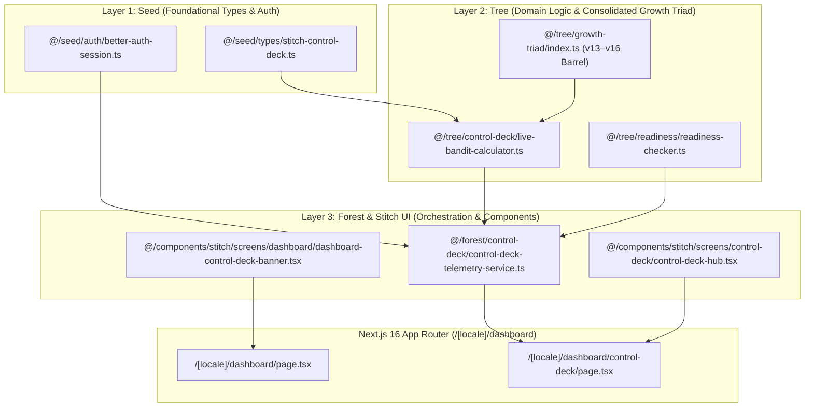

# /mk:brainstorm — Binh Pháp Strategic Contract & Execution Plan (Sophia AI Factory)

> **Session Date:** 2026-10-17
> **Design System Anchor:** Stitch Project `8279482791013273159` (*Direction A — Director's Control Deck*)
> **Status:** Approved & Executed via `/mk:brainstorm` → `/mk:plan` → `/mk:cook`

---

## 1. Brainstorm Contract (4 Mandatory Fields)

| Field | Contract Specification |
|---|---|
| **Outcome** | Unified execution of all 3 strategic tracks: 1. **Production Route Rollout:** Wire the 9-screen Stitch *Director's Control Deck* (`/[locale]/dashboard/control-deck`) and quick-launch banner (`DashboardControlDeckBanner`) into `/[locale]/dashboard`. 2. **Deep Binh Pháp 4-Layer Consolidation:** Consolidate fragmented `tree/growth-v13..v16` engines under canonical barrel `@/tree/growth-triad` and enforce `< 180 LOC` across all new modules. 3. **Live Backend Wiring:** Connect `getCurrentUser`, `verifyUserReadiness`, `fetchCurrentUserDashboard`, and live Thompson Sampling + Half-Kelly calculation (`computeLiveControlDeckDataset`) via `@/forest/control-deck`. |
| **Constraints** | • Preserve Protected Flows (Setup Wizard, `@Sophia_Bbot` Telegram Bot, NOWPayments USDT IPN). • Strict 4-layer import boundaries (`seed -> tree -> forest -> land`). • Do not mutate the 14-item `SOPHIA_NAV_MODULES` array pinned by `dashboard-sidebar-nav.challenger.test.tsx`. • `< 180 LOC` per file, `zero :any`, `zero console.log`, bilingual `VI/EN` parity. |
| **Non-goals** | • No breaking SQL/D1 schema migrations. • No non-approved payment providers (strictly NOWPayments USDT primary + PayOS domestic backup). |
| **Acceptance Criteria** | • Plan written to `docs/architecture/mk-brainstorm-control-deck-restructuring-plan.md`. • `check-layer-boundaries.sh` = 0 violations. • `npm run i18n:validate` = 0 missing keys. • `npm run ci:typecheck` (`tsc --noEmit`) = 0 errors. • Vitest unit suites for `ControlDeckHub`, `DashboardComponents`, and `ControlDeckTelemetryService` = 100% PASS. |

---

## 2. Architecture & Trade-Off Matrix (3 Combined Tracks)

| Track | Approach | YAGNI / KISS / DRY Rationale |
|---|---|---|
| **Track 1: Production Route Rollout** | Mount `DashboardControlDeckBanner` inside `DashboardPage` linking to `/dashboard/control-deck` | Exposes all 9 Stitch screens on the main `/dashboard` entry point while preserving the 14-item `SOPHIA_NAV_MODULES` invariant. |
| **Track 2: 4-Layer Consolidation** | Barrel `@/tree/growth-triad/index.ts` + `< 180 LOC` enforcement | Unifies `thompson-bandit`, `kelly-allocator`, `deliberation-consensus`, `shapley-attribution`, `survival-halt-predictor`, `audience-retention-normalizer`, and `prior-script-steerer` without breaking legacy imports. |
| **Track 3: Live Backend Wiring** | `@/forest/control-deck/control-deck-telemetry-service.ts` | Fetches live auth + BYOK readiness + transaction ledger on the server with graceful unauthenticated fallback. |

---

## 3. Complete 9/9 Stitch Screen → Next.js 16 Route Matrix

| # | Stitch Screen (`site/public/`) | Unified Hub (`/[locale]/dashboard/control-deck`) | Standalone Route Binding (`apps/sophia-ai-factory/src/app/[locale]/`) |
|---|---|---|---|
| 1 | `index.html` (Executive Command & MAB) | `ExecutiveMabPanel` | `/[locale]/dashboard` (`DashboardControlDeckBanner`) |
| 2 | `ask-advisors.html` (`/ask` 4-Advisor Council) | `AdvisorTimelinePanel` | `/[locale]/dashboard/missions` (`StitchStudioDeckStrip`) |
| 3 | `video-studio.html` (AI Video Timeline Studio) | `AdvisorTimelinePanel` | `/[locale]/dashboard/missions` (`StitchStudioDeckStrip`) |
| 4 | `billing-revenue.html` (USDT/PayOS Merkle Ledger) | `RevenuePortalsPanel` | `/[locale]/dashboard/affiliate` (`MerkleSettlementBanner`) |
| 5 | `setup-wizard.html` (Zero-Tech BYOK Vault) | `ControlDeckHub` Inspector | `/[locale]/dashboard/settings` (`StitchByokVaultBanner`) |
| 6 | `agency-portal.html` (White-Label Subaccounts) | `ControlDeckHub` Inspector | `/[locale]/partner` (`StitchAgencySubaccountStrip`) |
| 7 | `mobile-companion.html` (`@Sophia_Bbot` Pocket) | `ControlDeckHub` Inspector | `/[locale]/dashboard/approvals` (`StitchMobileCompanionBanner`) |
| 8 | `pricing.html` (Bilingual Pricing & ROI) | `ControlDeckHub` Inspector | `/[locale]/pricing` (`PricingRoiCalculator`) |
| 9 | `style-guide.html` (Design System v4.2) | `RevenuePortalsPanel` | `design-tokens.css` + `tailwind-theme.css` |

